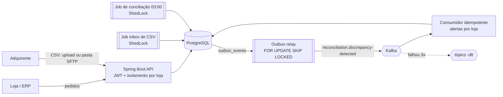

# Payment Reconciliation API

[](https://github.com/SamuelVNO/payment-reconciliation-api/actions/workflows/ci.yml)


API de **conciliação de pagamentos**. As lojas cadastram os pedidos que esperam receber, o sistema importa os repasses que o adquirente (Cielo, Stone, Getnet...) realmente pagou, cruza os dois e aponta cada centavo fora do lugar.

| Divergência | Exemplo |
|---|---|
| `MISSING_PAYOUT` | Pedido de R$ 75,00 sem repasse depois do prazo de D+2 |
| `AMOUNT_MISMATCH` | Pedido de R$ 200,00, repasse bruto de R$ 180,00 |
| `FEE_OVERCHARGED` | Taxa contratada de 2,99% (R$ 2,69), adquirente cobrou R$ 3,50 |
| `DUPLICATE_PAYOUT` | O mesmo pedido pago duas vezes |
| `ORPHAN_PAYOUT` | Repasse que não bate com nenhum pedido da loja |

O domínio foi escolhido porque obriga a lidar com dinheiro com precisão, idempotência, jobs agendados, mensageria e consultas pesadas no banco.

## Arquitetura



Monólito modular organizado **por feature** (`store`, `order`, `payout`, `reconciliation`, `auth`, `notification`, `shared`). Cada pacote expõe só o que os outros precisam.

## Stack

Java 21 · Spring Boot 3.5 · Maven · PostgreSQL 17 · Spring Data JPA / Hibernate 6 · Flyway · Bean Validation · Spring Security 6 + JWT (resource server, HS256) · Kafka (spring-kafka, KRaft) · ShedLock · JUnit 5 · Mockito · Testcontainers · Actuator + Micrometer/Prometheus · logs estruturados ECS · springdoc-openapi · Docker / Compose · GitHub Actions

## Decisões técnicas que valem a conversa

**Dinheiro**
- `BigDecimal` + `NUMERIC(19,2)`, nunca `double`. Taxa com `NUMERIC(5,4)` e arredondamento `HALF_EVEN` (bancário).
- Comparações com `compareTo`, não `equals` (`10.0` e `10.00` são diferentes para o `equals`). Existe um teste que prova isso.

**Idempotência (três camadas)**
- Upload de CSV com header `Idempotency-Key`: repetir a requisição devolve o resultado original com `Idempotent-Replayed: true`, sem reprocessar.
- Repasse identificado por `payout_id`: o mesmo repasse em dois arquivos é contado como duplicado, não importado duas vezes.
- Motor de conciliação idempotente: `UNIQUE NULLS NOT DISTINCT (type, order_id, payout_id)` (Postgres 15+) impede divergência duplicada se o job rodar duas vezes.

**Performance no banco**
- Motor processa em lotes com **paginação keyset** (`id > :cursor`), não `OFFSET`, e cada lote tem a própria transação (`TransactionTemplate`).
- Repasses de um lote inteiro vêm em **um** `SELECT ... IN (...)`. O teste `DiscrepancyQueryIT` conta os SQLs e prova o N+1 da navegação lazy contra a projeção com JOIN.
- Índice composto `(store_id, reconciliation_status, id)`: com 300 mil pedidos, a query do lote caiu de **29,4 ms / 47.535 buffers** para **0,56 ms / 506 buffers** (`EXPLAIN ANALYZE`).
- Listagens com projeção direta em `record` via JPQL, `countQuery` explícita e `open-in-view=false`.

**Mensageria confiável**
- **Transactional Outbox**: a divergência e o evento são gravados na mesma transação. Sem dual write.
- Relay com `FOR UPDATE SKIP LOCKED`: várias instâncias publicam em paralelo sem pegar o mesmo evento.
- Producer com `acks=all` + idempotência; consumidor **idempotente** (`event_id` único); retry com backoff e **dead-letter topic** para mensagens envenenadas.

**Segurança e multi-tenant**
- JWT HS256 emitido e validado com o resource server do Spring Security (Nimbus), sem biblioteca de terceiros.
- `ADMIN` gerencia lojas e usuários; `STORE_USER` só acessa `/api/stores/{seu storeId}/**`. A regra fica num `AuthorizationManager` na borda, e as queries também filtram por loja (defesa em profundidade).
- Senhas com BCrypt. O login roda o BCrypt mesmo quando o e-mail não existe e devolve a mesma mensagem nos dois casos, para não revelar quais e-mails estão cadastrados. 401/403 saem no mesmo formato de erro da API.

**Operação**
- Erros no padrão **RFC 9457** (`application/problem+json`) em toda a API.
- Jobs com **ShedLock**: com N instâncias, cada job roda em uma só.
- Probes de liveness/readiness, métricas próprias (`reconciliation_discrepancies_total{type}`, `reconciliation_run_duration_seconds`, `outbox_pending`) e logs JSON com `X-Request-Id` em cada linha.
- Imagem Docker multi-stage, em camadas, rodando sem root.

## Como rodar

Pré-requisito: Docker. Para desenvolver também: JDK 21.

**Tudo em container (API + Postgres + Kafka):**

```bash
docker compose up --build
./scripts/demo.sh    # fluxo completo: loja -> pedidos -> CSV -> conciliação -> alertas (precisa de curl e jq)
```

- Swagger UI: http://localhost:8080/swagger-ui.html (use `POST /api/auth/login` e cole o token em **Authorize**)
- Admin local: `admin@local.dev` / `admin12345` (só no Compose e no perfil `dev`; em produção vem de `ADMIN_EMAIL`/`ADMIN_PASSWORD`)

**Modo desenvolvimento:**

```bash
docker compose up -d postgres kafka
./mvnw spring-boot:run        # sobe com o perfil dev
```

**Testes** (Docker precisa estar rodando):

```bash
./mvnw test      # 25 testes unitários e de fatia web, sem Docker, em segundos
./mvnw verify    # + 18 testes de integração com Postgres e Kafka reais via Testcontainers
```

## Endpoints

| Método | Rota | Quem |
|---|---|---|
| `POST` | `/api/auth/login` | público |
| `GET` | `/api/auth/me` | autenticado |
| `POST` | `/api/users` | ADMIN |
| `POST` `GET` | `/api/stores` | ADMIN |
| `GET` `PUT` | `/api/stores/{id}` | loja dona / ADMIN (PUT só ADMIN) |
| `POST` `GET` | `/api/stores/{id}/orders` | loja dona / ADMIN |
| `POST` | `/api/stores/{id}/payout-imports` (multipart + `Idempotency-Key`) | loja dona / ADMIN |
| `GET` | `/api/stores/{id}/payouts` | loja dona / ADMIN |
| `POST` `GET` | `/api/stores/{id}/reconciliation-runs` | loja dona / ADMIN |
| `GET` | `/api/stores/{id}/discrepancies?type=&status=` | loja dona / ADMIN |
| `PATCH` | `/api/stores/{id}/discrepancies/{discrepancyId}/resolve` | loja dona / ADMIN |
| `GET` | `/api/stores/{id}/reconciliation-report?from=&to=` | loja dona / ADMIN |
| `GET` | `/api/stores/{id}/alerts` | loja dona / ADMIN |
| `GET` | `/actuator/health/{liveness,readiness}` | público |
| `GET` | `/actuator/prometheus` | ADMIN |

Formato do CSV de repasses: [`samples/payouts-2026-09.csv`](samples/payouts-2026-09.csv). O job de inbox lê `payout-inbox/{storeId}/*.csv` a cada 5 minutos.

## Configuração

| Variável | Padrão | Descrição |
|---|---|---|
| `DB_URL` / `DB_USERNAME` / `DB_PASSWORD` | `localhost:5432/reconciliation`, `app`, `app` | PostgreSQL |
| `KAFKA_BOOTSTRAP_SERVERS` | `localhost:9092` | Kafka |
| `JWT_SECRET` | **obrigatório** fora do perfil dev | chave HS256, mínimo 32 bytes |
| `ADMIN_EMAIL` / `ADMIN_PASSWORD` | vazio | cria o primeiro ADMIN no boot |
| `SCHEDULING_ENABLED` | `true` | liga os jobs agendados |
| `PAYOUT_INBOX_DIR` | `./payout-inbox` | pasta lida pelo job de importação |
| `RECONCILIATION_CRON` | `0 0 3 * * *` | conciliação noturna (America/Sao_Paulo) |
| `LOGGING_STRUCTURED_FORMAT_CONSOLE` | vazio | `ecs` para logs em JSON |

## CI/CD

A cada push, o GitHub Actions roda `./mvnw verify` (unitários + Testcontainers com Postgres e Kafka reais) e guarda os relatórios. Na `main`, publica a imagem em `ghcr.io/samuelvno/payment-reconciliation-api` com as tags `latest` e o SHA do commit. Qualquer host com Docker roda a imagem passando as variáveis acima, com um Postgres e um Kafka gerenciados.

## Estrutura

```
src/main/java/io/github/samuelvno/paymentreconciliation
├── store/            lojas (tenants) e taxa contratada
├── order/            pedidos esperados
├── payout/           importação de CSV, idempotência, job de inbox
├── reconciliation/   regras, motor em lotes, divergências, relatório
├── auth/             usuários, login, emissão de JWT
├── notification/     consumidor Kafka e alertas por loja
└── shared/           erros (RFC 9457), segurança, outbox, config, filtros
src/main/resources/db/migration   V1..V6 (Flyway)
```

## Próximos passos

- Migrar para Spring Boot 4 / Spring Framework 7.
- Avaliar virtual threads (`spring.threads.virtual.enabled`) com teste de carga antes de ligar.
- Health indicator do Kafka na readiness e alerta no Prometheus para `outbox_pending` crescendo.
- Particionar `payouts` por mês quando o volume justificar.
